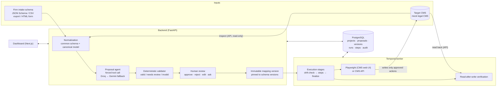

# Legal CMS Onboarding & Integration Agent

An agent that onboards a law firm's existing intake forms into a case management system (CMS):
it discovers the firm's fields, inspects the CMS, **proposes** field mappings with an LLM,
**validates** them with deterministic rules, lets a **person approve** an immutable version, then
**applies** it through the CMS's web UI (Playwright) or API and **verifies** the result by reading
the configuration back. Runs are durable (Temporal): a crashed worker resumes without repeating
any change.

> The goal is not to make the model guess every field. It automates the mappings it can justify
> and routes everything else to a human decision.

All firms, people and data in this repository are **fictional**. The "CMS" is a mock built for
this project (`mock-cms/`).

## How it works



| Component | Where | Responsibility |
|---|---|---|
| Mock CMS | `mock-cms/` | The target system: login, roles, configurable fields, intake mappings, form submission, HTML UI + JSON API, switchable UI release (v1/v2) |
| Backend API | `backend/app/api` | Firms, users, connectors, projects, schemas, proposals, review, approval, execution, verification, audit |
| Normalization | `backend/app/domain/parsers`, `schemas/normalized.py`, `domain/canonical.py` | One representation for every source and target schema; canonical legal model |
| Agent | `backend/app/agent` | Provider-neutral LLM client, versioned prompts, typed tool registry (proposal tools only) |
| Validator | `backend/app/domain/mapping_validator.py` | Pure, deterministic rules; the model's confidence can only lower a status |
| Execution | `backend/app/domain/execution_*.py`, `integrations/` | Plan from an approved version, drift pre-flight, read-before-write, read-back verification; browser (Playwright) and API writers |
| Orchestration | `backend/app/workflows` | Temporal workflow + activities, worker with start-up recovery |
| Dashboard | `frontend/` | Review and approval UI that explains every outcome in plain language |
| Evaluation | `backend/app/evaluation`, `fixtures/evaluation`, `scripts/run_evaluations.py` | 46 labelled scenarios, metrics, report |

**Tech stack:** Python 3.13, FastAPI, Pydantic, SQLAlchemy + Alembic, PostgreSQL 17, Playwright,
Temporal, Groq (`openai/gpt-oss-120b`) with Gemini (`gemini-3.5-flash-lite`) fallback,
OpenTelemetry, Next.js 15 + TypeScript, Docker Compose, GitHub Actions.

## Safety guarantees

- **No write without approval.** The only write endpoint executes an approved, immutable mapping
  version; the LLM's tool registry contains no write tools. Database triggers make approved
  versions, proposal content and the audit log tamper-proof.
- **The model proposes, code decides.** Unknown fields, unsupported transformations, incompatible
  types and CMS-managed fields are rejected deterministically; ambiguity, custom fields, low
  confidence and instruction-like text are routed to a person.
- **Prompt-injection resistance.** Uploaded and page text is passed only as delimited data, and
  instruction-like text is detected independently of the model and forces human review.
- **No false success.** A run succeeds only if the configuration read back from the CMS matches the
  approved plan.
- **No duplicates, safe retries.** Every step reads the CMS before writing; an attempt is recorded
  before its write; a write with an unknown outcome is checked before at most one retry.
- **Stop instead of guessing.** A missing or renamed UI control stops the run; later steps are not
  attempted; a trace and screenshot are kept.
- **Least privilege and tenant isolation.** Connector credentials live outside the database and
  prompts; the CMS account cannot read client records; every query is firm-scoped, backed by
  same-firm composite foreign keys; browser navigation is restricted to allowed origins
  (including redirects).

## Quick start

Prerequisites: Docker Desktop, Python 3.13, Node.js 22. Optional: a Groq and/or Gemini API key.

```powershell
copy .env.example .env                # then put GROQ_API_KEY / GEMINI_API_KEY in .env
docker compose up -d --build          # postgres, mock-cms :8100, backend :8200, temporal :7234/:8234, worker
docker compose exec mock-cms python -m app.seed
docker compose exec backend python -m app.seed

cd frontend; npm install; npm run build; npx next start -p 3000   # dashboard: http://localhost:3000
```

Sign in as `a.admin` / `demo-password` (Firm A administrator) or `a.specialist` (integration
specialist). Temporal's UI is at http://127.0.0.1:8234, the backend API docs at
http://localhost:8200/docs.

## Demonstration

Reproducible end-to-end demo against the running stack (writes a narrated transcript):

```powershell
backend\.venv\Scripts\python scripts\demo.py --reset     # --reset rebuilds the demo databases
```

It covers a normal onboarding, a re-run with no duplicate writes, a **deliberate failure with
safe recovery** (the CMS UI changes, the run stops with nothing written, the UI is restored and
the same approved version completes), authorization failures, a schema change after approval, a
worker crash mid-run, and a duplicate request. Latest transcript:
[docs/evidence/phase7-demo.md](docs/evidence/phase7-demo.md).

A dashboard walkthrough (Playwright, with screenshots of a successful and a failed onboarding) is
in `scripts/dashboard_walkthrough.py`; screenshots in
[docs/evidence/phase6-dashboard/](docs/evidence/phase6-dashboard/).

## Sample firms

| Firm | Source format | Characteristics |
|---|---|---|
| A — Alder & Associates | JSON Schema | Requires name, phone and matter category; enum vocabulary; a boolean and a file field with no CMS home |
| B — Birch Legal LLP | CSV field export | Different names (`adverse_party`, `court_jurisdiction`), picklists, a date with no CMS field |
| C — Cedar Law Group | HTML form | Coded options (`DIV`, `WRK`…), a required review status (needs a custom field), an ambiguous free-text field whose label carries a prompt-injection attempt |

Sources: `fixtures/source-schemas/`; labelled answers: `fixtures/expected-mappings/`.

## Evaluation

```powershell
backend\.venv\Scripts\python scripts\run_evaluations.py           # replay recorded answers (~25 s)
backend\.venv\Scripts\python scripts\run_evaluations.py --llm live # call the LLM and re-record
```

46 labelled scenarios: 18 mapping-quality (firm fixtures, synonyms, abbreviations, Spanish labels,
split names, ambiguity, incompatible types, missing required fields, unexpected CMS fields, coded
options, nested schemas, three prompt-injection variants), 12 validator rules and 16
execution-safety scenarios (renamed UI control, save timeout after success, lost write, crash after
write, repeated execution, unauthorized operation, superseded version, schema change, target
drift, silent wrong save, conflicts). Latest report:
[docs/evidence/evaluation-report.md](docs/evidence/evaluation-report.md).

| Metric | Result | Target |
|---|---|---|
| Clear mapping accuracy (67 fields) | 98.5 % | ≥ 95 % |
| Human-review recall (15 fields needing a person) | 100 % | high |
| Wrong proposals that passed validation | 0 | 0 |
| Validator / execution scenarios | 12/12 · 16/16 | all |
| Unsafe-write rate · duplicate-execution rate | 0 % · 0 % | 0 % |
| Verification success · recovery success | 100 % · 100 % | 100 % |
| False success reports | 0 | 0 |

These numbers come from synthetic, hand-labelled scenarios and describe this suite only — they are
not evidence of accuracy on real law-firm data.

## Failure scenarios handled

| Situation | Behaviour |
|---|---|
| Ambiguous field | Marked ambiguous; cannot be approved until a person edits it into a concrete decision |
| Incompatible types / invented field / unsupported transformation | Rejected by the validator; cannot be approved |
| Missing required source field | Reported as a coverage gap; the approved version is marked incomplete |
| Prompt-injection text in a form | Treated as data; detected and forced to human review |
| CMS UI control renamed | Run stops before the first write that needs it; trace + screenshot; nothing guessed |
| Save times out after succeeding | CMS is read back; the change is recognised, not written twice |
| Worker killed mid-run | Temporal resumes on a live worker; completed or interrupted writes are not repeated |
| Repeated or duplicate execution | Already-applied steps are skipped; the same Idempotency-Key returns the same run |
| Unauthorized operation / other firm's data | 403 / 404; nothing written |
| Schema changed after approval | Execution refused; propose and approve again |
| CMS changed since approval | Run blocked before any write |
| CMS stores a different value than sent | Run reported as `verification_failed`, never as success |

## Development

```powershell
docker compose up -d postgres temporal
cd mock-cms; py -3.13 -m venv .venv; .\.venv\Scripts\python -m pip install -e ".[dev]"; .\.venv\Scripts\python -m pytest
cd ..\backend; py -3.13 -m venv .venv; .\.venv\Scripts\python -m pip install -e ".[dev]"
.\.venv\Scripts\python -m playwright install chromium
.\.venv\Scripts\python -m pytest                 # unit, integration, browser e2e, durable runs
.\.venv\Scripts\python -m ruff check . ; .\.venv\Scripts\python -m mypy app tests
cd ..\frontend; npm install; npx tsc --noEmit; npm run lint; npm run build
```

CI (`.github/workflows/ci.yml`) runs the same checks plus the evaluation suite in replay mode and
dependency audits on every push.

## Repository layout

```text
backend/     FastAPI app, agent, domain logic, integrations, workflows, evaluation, tests
mock-cms/    simulated target CMS (separate service and virtualenv)
frontend/    Next.js dashboard
fixtures/    source schemas, target snapshot, expected mappings, evaluation scenarios
scripts/     run_evaluations.py, demo.py, dashboard_walkthrough.py
docs/        BLUEPRINT.md (requirements), evidence/ (reports, transcripts, screenshots)
```

Engineering rules: [CLAUDE.md](CLAUDE.md) · progress, evidence and known limitations per phase:
[IMPLEMENTATION_PROGRESS.md](IMPLEMENTATION_PROGRESS.md) · history:
[CHANGE_LOG.md](CHANGE_LOG.md) · requirements: [docs/BLUEPRINT.md](docs/BLUEPRINT.md).
